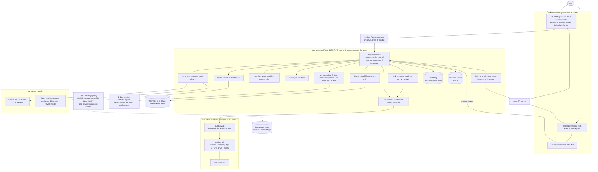
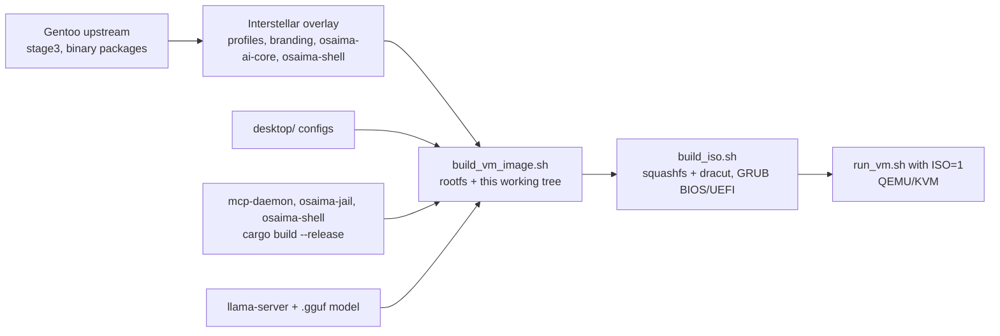

# OSAIMA / Interstellar OS: architecture

OSAIMA is the interface and AI core; Interstellar OS is the Gentoo-based
distribution that ships them. This file describes how the parts fit together, how
a request travels, and what stops a bad one. Claims and their limits are in
[docs/review/CLAIMS.md](docs/review/CLAIMS.md).

## 1. Component diagram

How to read it: the apps only ask; the daemon decides. Every path to an action
(shell, files, desktop, D-Bus) goes through the same request handler, which applies
the tier policy, the taint check and the audit log. The dotted line is the
router also providing document search.

## 2. Layers

| Layer | Responsibility | Implementation |
|---|---|---|
| UI and desktop | Show the assistant, approvals, results; hold real windows | sway, waybar, mako, Tauri apps (`ui/osaima-shell/`), `desktop/` |
| NLU and intent router | Decide fast path or LLM; extract parameters | `ai-core/intent-router/` (MiniLM + classifier head, 66 intents), `nlu.rs` |
| AI core / LLM | Understand open requests, write text, propose one command or a plan | `llm.rs`, prompts in `src/prompts/`, Gemini or llama.cpp, RAG |
| Execution and security | Classify risk, require approval, run safely | `security.rs`, `guard.rs`, `executor.rs`, `files.rs`, `desktop.rs`, `os_control.rs` |
| Kernel and system | Enforce limits; provide devices and desktop services | Linux (namespaces, Landlock, seccomp), D-Bus, sway IPC, systemd user services |
| Feedback and learning | Remember what the user does and says | `behavior.rs`, SQLite (`ai-core/behavior/schema.sql`) |
| Audit | Record every decision in a tamper-evident log | `security.rs` audit log, `system.audit_tail`, `system.audit_verify` |

## 3. Request flows

### 3.1 A single command ("set brightness to 80%")

1. The Assistant window sends the text, plus the last six conversation turns, to the
   daemon (`system.classify_intent`) through the bridge.
2. The daemon asks the intent router. The router embeds the sentence, classifies
   it, extracts slots, and returns a confidence. If it is high enough, the intent
   can be run by the shell, and no outside content is attached, the answer is the
   **fast path**: no LLM call. Measured p50 35.7 ms.
3. The Assistant maps the intent to an action and calls `system.os_action`.
4. The daemon looks up the action's tier in `os_control::policy`. Reversible
   changes such as volume run at once; actions that can cut the user off (wifi or
   bluetooth off, closing every window) need approval; power actions need approval
   plus the typed word `confirm`. Tainted actions always need approval.
5. If allowed, the daemon performs it (D-Bus or sway), writes an `os_action` record
   to the audit log, and the Assistant shows the result with who answered and how
   fast.

If the router is not sure, or the request is open-ended, the daemon goes to the
LLM instead (step 2 of the next flow).

### 3.2 An open-ended command ("show me the five largest files in my home directory")

1. As above, the router cannot settle it, so the daemon picks a task for the LLM:
   write text, propose one command, or classify. Question-like requests also get two
   short knowledge passages, fenced as `<reference>`.
2. `llm.rs` calls Gemini (three Flash-Lite models on one key, 8 s timeout) or, in
   Private mode or on failure, the local llama.cpp server. The system prompt is
   fixed (so it can be cached) and ends with the security rules and a canary token.
3. The reply is checked: if it leaks the canary the answer is rejected and an
   `injection_blocked` record is written. The daemon annotates the proposed
   command with its tier and reasons.
4. The Assistant shows a card: the command, the tier (edge colour), the reasons.
   Read-only commands run immediately; reversible ones wait for a click;
   irreversible ones wait for the click and the typed `confirm`.
5. On approval the Assistant calls `system.execute_command`. The daemon **assesses
   the command again** (it never trusts the tier the UI showed), applies the taint
   check, and refuses if approval is missing.
6. The executor runs it: bubblewrap (read-only root, private /tmp, home writable only
   for reversible and irreversible tiers) then `osaima-jail`. The result includes
   what was actually enforced, e.g. `bubblewrap+landlock+seccomp`. An `execute`
   record goes to the audit log.

### 3.3 A multi-step plan ("make a folder called Reports and move both report pdfs into it")

1. The request names an existing folder, so the daemon adds that folder's real
   file names to the prompt (fenced as untrusted, since a name can carry an
   injection) and skips the knowledge lookup.
2. The model returns a list of steps. Later steps can refer to earlier results
   (`from_step`), so it does not have to guess names.
3. The Assistant renders **one card**: every step with the daemon's tier for it.
   One approval covers the steps shown, with typed `confirm` if any step cannot be
   undone.
4. Steps run in order, each through the normal gate (`system.os_action` or
   `system.execute_command`), with live status. The first failure stops the plan and
   skips the rest.
5. One button, **Undo the whole plan**, reverses the file changes newest first.

### 3.3b An agent task ("create a small python command-line tool in ~/projects/demo-wordcount ... and run the test")

1. The request is routed as a *task* (not a one-shot command). The model first
   proposes a **scope**: the one folder it may change, whether it needs the network,
   and an outline. The Assistant shows it as a card with its limits.
2. The user approves the scope once (`task_start`, then `task_decide`).
3. The daemon runs a loop in the background. The model calls one tool
   (`run_command`, `write_file`, `read_file`, `list_dir`, `open_for_user`), the daemon
   runs it and returns the result as data, and the model decides the next step. Limits:
   30 steps, 20 minutes in total, 5 minutes per step.
4. Commands and file tools both run inside bubblewrap + `osaima-jail`, with Landlock
   write access to the approved folder only and no root (`sudo`/`su` refused before
   they run). Any step rated irreversible pauses the task for the typed `confirm`.
   `open_for_user` opens only files in the task folder, never programs or launchers.
5. Every step is written to the audit log; the live task card shows steps and
   output, takes approvals in place, can be stopped (`task_cancel`), and ends with a
   summary. The canary check applies to every model reply.

Routines: after a successful plan the Assistant offers to save it (steps listed, not
offered if outside text was involved). `system.routine_save` stores it in the
behaviour store; typing "run my X routine" or clicking it in the rail makes
`classify_intent` return the saved steps as a plan, which goes through the normal
plan card, so every replay asks for approval.

### 3.4 A file request, and "Ask OSAIMA"

Typed file actions (`files.rs`): search by name words, kind, size, age; list; open;
show in Thunar (D-Bus, file selected); copy; move; rename; new folder; move to
Trash. Paths are arguments, never shell text. Each path is resolved without
touching the disk and must be inside `$HOME` and outside protected places
(`~/.ssh`, `~/.gnupg`, keyrings, OSAIMA's key file and audit log). A move goes
only into an existing folder; nothing is overwritten. `files::check` rejects an
impossible request before the user is asked to approve it. Tiers: search, list,
open, reveal are read-only; copy, new folder, undo are reversible without asking;
move, rename and trash need one click. Undo keeps an in-memory change log.

"Ask OSAIMA":

1. In Thunar the user selects files and picks **Ask OSAIMA**. The action runs
   `osaima-ask`, which sends the paths to the daemon (`system.share`) and brings
   the assistant forward.
2. The assistant fetches them (`system.shared_take`) and shows "About report.pdf".
3. With the user's question, the paths travel in the request. The daemon adds each
   file's location and readable text (PDF via `pdftotext`, first 5 pages; text and
   code files), up to five files, fenced as untrusted context.
4. The model answers from the document. Any action it proposes while that context
   is present is tainted and needs approval.

## 4. Security model

Assume the model can be wrong or manipulated, and the assistant daemon is not a
security boundary. The defence is in layers, each of which holds if the one before
it fails.

| Layer | What it does | Where |
|---|---|---|
| 1. Untrusted-content handling | Outside text is stripped of instruction-like patterns, fenced in `<untrusted_context>` (or `<reference>` for the knowledge base), and the system prompt tells the model to treat it as data | `guard.rs` |
| 2. Canary | A random per-process token in the prompt; if it appears in output the answer is rejected | `guard.rs` |
| 3. Taint | Any action proposed while untrusted text was in the prompt is remembered for 30 minutes and always needs approval, irreversible ones the typed phrase | `guard.rs`, `main.rs` |
| 4. Risk tiers | Daemon classifies each command (only looks / reversible / irreversible), judging the riskiest part of a pipeline and the commands inside `$(...)`, `xargs`, `find -exec`; unknown programs default to reversible | `security.rs` |
| 5. Approval | Tier decides: none, one click, or click plus typed `confirm`. Re-checked at execution; the UI cannot lower it | `main.rs`, `apps.js` |
| 6. Typed actions | File and desktop operations never go through a shell. Apps launch from a fixed table; search text is percent-encoded; files are confined to `$HOME` minus secrets | `files.rs`, `desktop.rs` |
| 7. Sandbox | bubblewrap: read-only root, private /tmp, new namespaces (network shared), die with parent, 60 s timeout. Environment emptied except an allowlist; `/run/user/<uid>` (daemon socket, session bus, Wayland, sway) and the system bus are empty inside; keys, tokens and browser profiles hidden. Fallback: systemd transient service | `executor.rs` |
| 8. Kernel limits | `osaima-jail`: Landlock (read/execute-only except /tmp, /dev and, for approved changes, `$HOME`), seccomp-bpf (EPERM for mount, ptrace, module loading, kexec, bpf, namespaces, reboot and others), `no_new_privs`, rlimits; on Linux 6.12+ Landlock also blocks abstract unix sockets and signals outside the sandbox. Inherited by children; cannot be lifted from inside | `src/bin/osaima-jail.rs` |
| 9. Audit | Every assessment, refusal, execution, OS action and injection event is appended to a log in which each record holds the SHA-256 of the previous one; `system.audit_verify` finds the first broken line | `security.rs` |
| 10. Secrets | The Gemini key is stored in `~/.config/osaima/llm.env`, mode 0600; the image and repo contain none | `llm.rs` |

What this does not give you:

- The daemon and the LLM client run as an ordinary user process. The kernel limits
  the *commands* the AI runs, not the AI process. The AppArmor profile in
  `ai-core/security/apparmor/` is only a first stage: it permits user namespaces and
  does not yet confine the daemon.
- An approved command can still change anything in `$HOME`, and can use the network.
- The risk classifier reads command text; it is not a proof of safety.
- The audit log is tamper-evident, not tamper-proof.
- In Fast mode the user's text and attached file text are sent to Gemini.

Measured effect (`ai-core/evaluation/RESULTS.md`): 50 injection attacks, 1 counted
as successful by the strict metric (#37, a harmless `lsblk`), 5 more fooled the
model but were stopped by the gates; kernel layer 6/6; sandbox isolation 5/5 (API
key, daemon socket, session bus, stored key, SSH keys unreachable); agent tasks 3/3.
The red-team did not target the agent loop specifically.

## 5. The language-model backend

| Mode | Order tried | Notes |
|---|---|---|
| Private (default) | Local llama.cpp server first (port 8080); a cloud model only if the user added a key and the local one fails | Free, no account; nothing leaves the machine when it works; 10-150 s per answer on a CPU laptop |
| Fast (optional) | Gemini 3.5 Flash-Lite, then two other Flash-Lite models on the same key, then the local model | Needs the user's own key; adding a key does not switch to it, the user chooses it in Settings; 8 s cloud timeout; IPv4-only client |

Switch at runtime with `system.set_llm_mode` (Settings). The router and all gates run
locally in both modes. The local model is started by `ai-core/llm/start-llm.sh`,
which picks a model from available RAM, uses all cores but one, and unloads the
model after 15 minutes idle.

## 6. Learning

`behavior.rs` also stores saved routines. It writes every request (text, intent, fast or LLM path, action,
outcome) to SQLite. Suggestion chips are the user's own safe fast-path commands,
weighted by frequency, recency and hour of day. "Remember that I prefer ..." is
stored as a preference and given to the LLM when it writes text; "forget my
preferences" clears them. Nothing is trained; there is no learning from user edits.

## 7. Distribution and build

The image runs the router, LLM server and daemon as systemd user services for the
desktop user, autologs in on tty1 and starts sway with `desktop/sway/config`. The
LLM weights sit uncompressed on the ISO (model load at boot dropped from over four
minutes to 58 s). The build scripts mount the chroot's /proc, /sys, /dev and /run as slave mounts
(`mount --rbind --make-rslave`) and refuse to unmount anything still marked shared,
because unmounting a shared copy would also unmount the host's own `/run/user/<uid>`
and take down the builder's desktop session. The source-build path (`build_distro.sh`, see
[BUILD-DISTRO.md](BUILD-DISTRO.md)) remains for a full Portage build.

## 8. Where it differs from the PDR

The concept is unchanged: an assistant as the OS shell, risk-tiered, sandboxed,
audited, learning. Implementation choices changed on purpose: Gemini by default
for speed (local model as Private mode and offline fallback); Gentoo and sway
instead of Ubuntu and GNOME; bubblewrap + Landlock + seccomp instead of
`systemd-run` + AppArmor; a MiniLM classifier head instead of BERT-tiny; RAG on the
router's encoder without a vector database. Voice input and learning from edits
are not built. The reasons are in [docs/review/CLAIMS.md](docs/review/CLAIMS.md)
section G.
